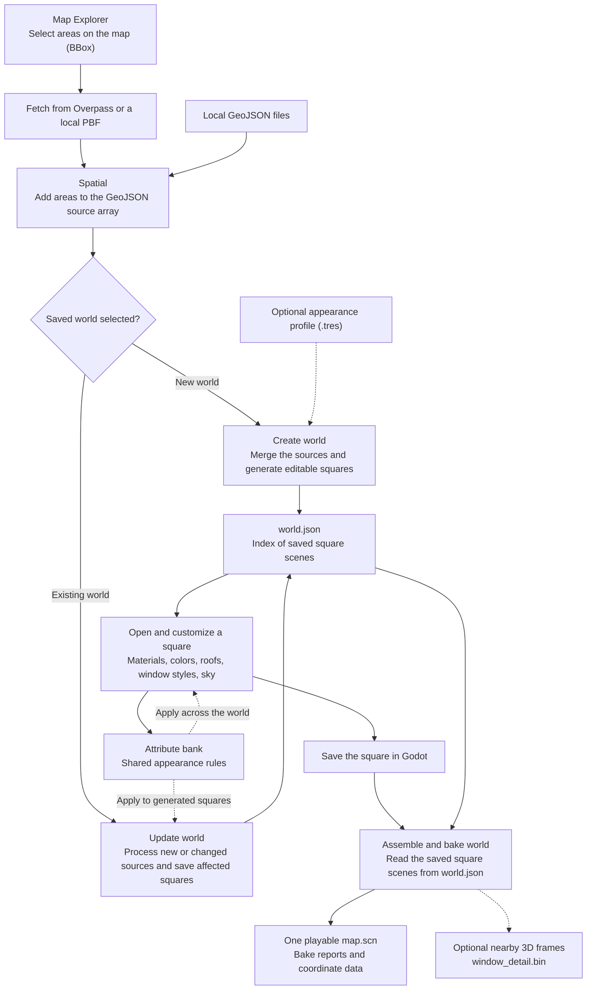

# Godot Spatial Toolkit

[Русская версия](./README.ru.md)

Spatial Toolkit **v0.8.0** is a Godot 4 editor addon for turning GeoJSON and OpenStreetMap data into editable worlds and playable 3D maps. It has been tested with Godot 4.7.2 and 4.6.3.

## Install

1. Copy `addons/spatial_toolkit` into your Godot project.
2. Enable **Spatial Toolkit** in **Project → Project Settings → Plugins**.
3. Open **Project Settings → General → Spatial Toolkit → Python**. Set the Python executable and run the dependency check below it. World generation needs Python 3.10 or newer, pyproj and GEOS 3.10 or newer. Local PBF extraction also requires GDAL 3.10 or newer with Python bindings and the OSM driver.

Local GeoJSON import works offline. Map Explorer uses online tile and Overpass services. Configure the shared proxy address and individual service switches under **Spatial Toolkit → Network**.

## From selected areas to a playable map

1. Open **Map Explorer** in Godot's main workspace to use its live XYZ map. In **Spatial Toolkit → Map Areas**, the table lists the bounds and status of each area. On the right, choose **Overpass API** or a local OSM PBF file. **Draw BBox** opens the map for drawing, and double-clicking a row opens it for editing. Check areas to fetch them as a batch or send their GeoJSON to **Spatial**.
2. Use **Create world** to merge the sources and create editable squares. To extend a world, keep its `world.json` selected under **Saved world**, add the new areas to the source array, then press **Update world**. The update saves only affected squares.
3. Open **Spatial Toolkit → Chunks** in the bottom panel. Filter the list by part of a square ID or an OSM name. Select a square to see its name on the preview and its OSM details alongside it. Double-click a row to edit the square's layers and building groups in the Inspector. The world's `attribute_bank.tres` shares appearance assignments across squares. Save scene edits in Godot.
4. Set the optional **Add drone** and **Nearby 3D window frames** flags, then press **Assemble and bake world**. Spatial builds a separate playable `map.scn` from the saved squares, batches compatible meshes, and can merge static collisions. The output includes reports and `world_data.json` with roads and building data. The 3D frame option saves window positions in `window_detail.bin`. Open the baked scene and press **F6** to play.

Open a local GeoJSON file in Map Explorer to start without fetching an area. The **Textures** tab imports PBR materials from Poly Haven and ambientCG. Double-click a catalog entry to import it, then drag the saved material to a compatible Inspector field. Flight audio can be assigned in the camera Inspector.

[Changelog](./CHANGELOG.md) · [MIT license](./LICENSE)
