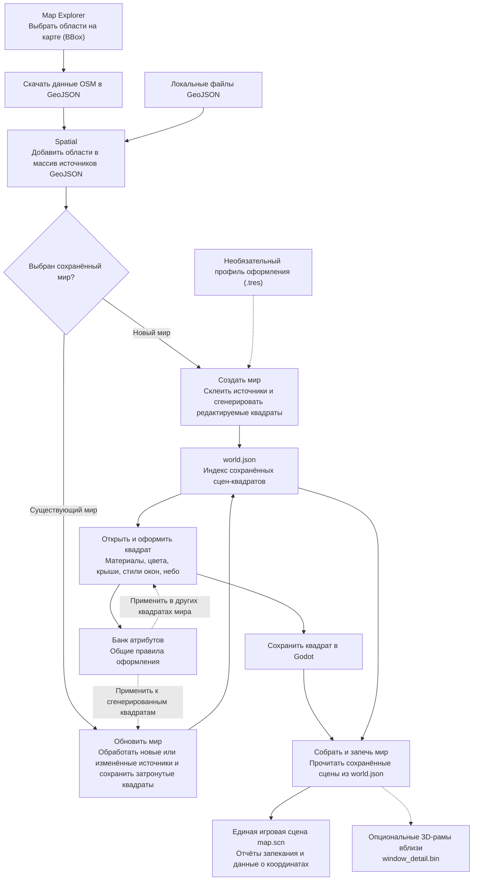

# Godot Spatial Toolkit

[English version](./README.md)

Spatial Toolkit — плагин для редактора Godot 4, который превращает GeoJSON в редактируемые трёхмерные карты. В нём есть Map Explorer, импорт в нативную сцену Godot, профили оформления, запекание сцен и опциональный режим полёта с дроном.

## Установка

1. Скопируйте `addons/spatial_toolkit` в свой проект Godot.
2. Включите **Spatial Toolkit** в меню **Проект → Настройки проекта → Плагины**.
3. Откройте **Spatial**, укажите путь к Python и запустите проверку зависимостей. Для импорта нужны Python 3.10 или новее, pyproj и GEOS 3.10 или новее.
4. Откройте GeoJSON в **Map Explorer** и нажмите **Send GeoJSON to Spatial**. Выберите параметры импорта и нажмите **Создать карту**. В выбранной папке появится отдельная сцена Godot.

Плагин проверен на Godot 4.7.2 и 4.6.3. Импорт локального GeoJSON работает офлайн. Map Explorer может получать данные из онлайн-источников.

## Оформление карты

В плагин входят процедурные материалы и контроллер дрона. Свои текстуры и материалы можно добавить в проект или импортировать через Asset Browser. В Spatial нажмите **Сохранить оформление…**, чтобы записать материалы и цвета открытой карты в профиль `.tres` и использовать его при следующем импорте. Звуки полёта можно назначить в инспекторе камеры.

## Рабочий процесс от выбранных областей до игровой карты

Схема описывает рабочую версию для следующего обновления отдельного аддона. Шаги установки выше относятся к текущей опубликованной сборке.

1. В **Map Explorer** выделите области на карте, скачайте их и отправьте GeoJSON в **Spatial**. Можно начать и с локальных файлов GeoJSON.
2. Нажмите **Создать мир**, чтобы склеить источники и получить редактируемые квадраты. Для расширения мира оставьте его `world.json` выбранным в поле **Сохранённый мир**, добавьте новые области в массив источников и нажмите **Обновить мир**. Обновление сохраняет только затронутые квадраты.
3. Нажмите **Открыть выбранный квадрат** и настройте слои и группы зданий в Inspector. Здесь можно назначить материалы, оттенки, варианты крыш и стили окон, а также посмотреть небо. Банк мира `attribute_bank.tres` распространяет оформление групп и отдельных объектов между квадратами. Кнопка **Сохранить оформление…** записывает профиль для другого мира. Правки сцены сохраните в Godot.
4. По желанию включите **Добавить дрон** и **3D-рамы вблизи**, затем нажмите **Собрать и запечь мир**. Spatial собирает сохранённые квадраты в отдельную игровую сцену `map.scn`, группирует совместимые меши и может объединить статические коллизии. Рядом сохраняются отчёты и `world_data.json` с данными о дорогах и зданиях. Опция 3D-рам сохраняет их координаты в `window_detail.bin`. Откройте запечённую сцену и запустите её клавишей **F6**.

## Лицензия

[MIT](./LICENSE)
