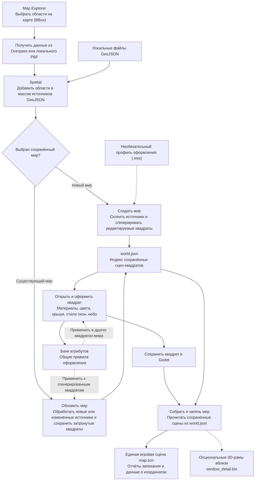

# Godot Spatial Toolkit

[English version](./README.md)

Spatial Toolkit **v0.10.0** — аддон для редактора Godot 4, который превращает GeoJSON и данные OpenStreetMap в редактируемые миры и игровые трёхмерные карты. Проверен на Godot 4.7.2 и 4.6.3.

## Установка

1. Скопируйте `addons/spatial_toolkit` в свой проект Godot.
2. Включите **Spatial Toolkit** в меню **Проект → Настройки проекта → Плагины**.
3. Откройте **Настройки проекта → Общие → Spatial Toolkit → Python**. Укажите путь к Python и запустите проверку зависимостей под полем. Для генерации нужны Python 3.10 или новее, pyproj и GEOS 3.10 или новее. Для чтения локального PBF дополнительно нужен GDAL 3.10 или новее с Python-биндингами и драйвером OSM.

Импорт локального GeoJSON работает офлайн. Map Explorer использует сетевые сервисы тайлов и Overpass. Общий адрес прокси и флажки для отдельных сервисов находятся в **Spatial Toolkit → Network**.

Выберите в Map Explorer один из пресетов CityGML — Хельсинки, Мюнхен, Монреаль, Цюрих или Лион. Если архива ещё нет в кэше, подтвердите загрузку. Пункт **3D-данные → Скачать 3D-архив** повторяет загрузку, а **Открыть каталог данных** открывает страницу поставщика. Архивы сохраняются в `user://spatial_toolkit/citygml/`. Перед созданием мира загрузите и отправьте слой зданий OSM для выделенной области.

## От выбранных областей до игровой карты

1. Откройте **Map Explorer** в основной рабочей области Godot, чтобы пользоваться живой XYZ-картой. В нижнем доке **Spatial Toolkit → Map Areas** таблица показывает размеры и статус областей. Справа выберите **Overpass API** или локальный файл OSM PBF. Кнопка **Draw BBox** открывает карту для рисования, двойной щелчок по строке — для редактирования. Отметьте области, чтобы получить их пакетом или отправить сохранённые GeoJSON в **Spatial**.
2. Нажмите **Создать мир**, чтобы склеить источники и получить редактируемые квадраты. Для расширения мира оставьте его `world.json` выбранным в поле **Сохранённый мир**, добавьте новые области в массив источников и нажмите **Обновить мир**. Обновление сохраняет только затронутые квадраты.
3. Откройте **Spatial Toolkit → Чанки** в нижней панели. Список можно отфильтровать по части ID квадрата или названия объекта OSM. При выборе квадрата его название появится на предпросмотре, а сведения об объектах OSM — рядом. Двойной щелчок по строке открывает сцену для редактирования слоёв и групп в Inspector. Банк мира `attribute_bank.tres` хранит общее оформление. Сохранение одного квадрата обновляет оформление остальных и показывает прогресс в панели.
4. По желанию включите **Добавить дрон** и **3D-рамы вблизи**, затем нажмите **Собрать и запечь мир**. Spatial собирает сохранённые квадраты в отдельную игровую сцену `map.scn`, группирует совместимые меши и может объединить статические коллизии. Рядом сохраняются отчёты и `world_data.json` с данными о дорогах и зданиях. Опция 3D-рам сохраняет их координаты в `window_detail.bin`. Откройте запечённую сцену и запустите её клавишей **F6**.
5. Для летающих патрулей выберите сохранённый результат и нажмите **Построить граф полётов** в панели **Spatial**. Затем добавьте менеджер патрулей и нарисуйте зоны в редакторе. Граф полётов сохраняется рядом с игровой сценой.

Чтобы начать с локального GeoJSON, откройте файл в Map Explorer. Вкладка **Текстуры** импортирует PBR-материалы из Poly Haven и ambientCG. Дважды щёлкните по материалу в каталоге, затем перетащите сохранённый ресурс в совместимое поле инспектора. Звуки полёта можно назначить в инспекторе камеры.

[Управление дроном](./docs/DRONE_CONTROLS.md) · [Список изменений](./CHANGELOG.md) · [Лицензия MIT](./LICENSE)
